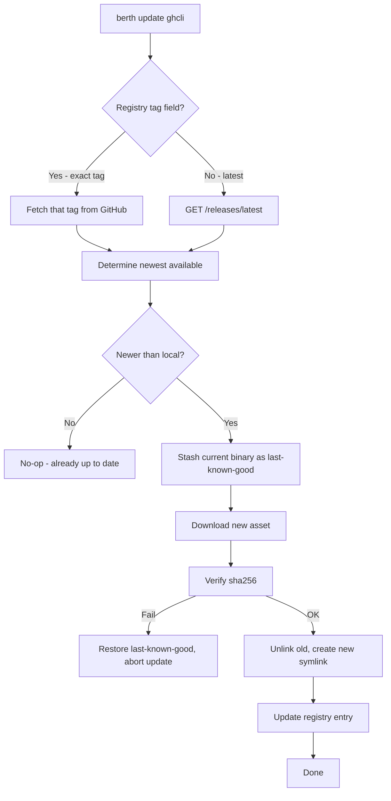

# Berth (bh) - CLI Package Manager for Standalone Executables

## Overview

Berth (short: **bh**) is a personal, cross-distro CLI package manager for Linux
that manages standalone binary executables (CLI tools, apps). It installs,
updates, lists, rolls back, and removes executables the way `brew`, `apt`, or
`npm` do, but scoped to a single user managing one-off binaries.

**Primary use case:** The user previously downloaded executables and manually
copied/symlinked them into `~/.local/bin`. Berth automates and manages the
whole lifecycle.

**Language:** Rust (edition 2021+).

---

## Directories & Locations

| Path | Purpose |
|---|---|
| `~/.config/berth/config.toml` | Global config + optional `gh_token` |
| `~/.local/share/berth/` | Berth's managed data dir (XDG-compliant) |
| `~/.local/share/berth/bin/` | Real binaries, organized as `<tool>/<version>/<binary>` |
| `~/.local/share/berth/registry.toml` | The install manifest (source of truth) |
| `~/.local/share/berth/cache/` | Downloads + previous versions (for rollback) |
| `~/.local/bin/` | Symlinks go here (auto-add to PATH if missing) |

## The Symlink Approach (CRITICAL)

Berth **never** copies binaries directly into `~/.local/bin`.

1. The real binary lives at `~/.local/share/berth/bin/<tool>/<version>/<binary>`
2. Berth creates a **symlink** in `~/.local/bin/` pointing to the real binary
3. On update, the old version stays in its versioned dir (enables rollback)
4. On remove/uninstall, only the symlink + registry entry are removed; the
   binary stays cached

```text
~/.local/bin/gh  ->  ~/.local/share/berth/bin/ghcli/v2.43.0/gh
```

---

## Config File (`~/.config/berth/config.toml`)

```toml
[sources]
# Optional. Empty by default. Filled in by the user only if they hit GitHub
# rate limits (60/hr public) or need private repos (1000/hr when set).
gh_token = ""

[paths]
bin_dir      = "~/.local/bin"
store_dir    = "~/.local/share/berth/bin"
registry_dir = "~/.local/share/berth"
```

Resolve `~` using the user's home directory. Use absolute paths internally.

## Registry File (`~/.local/share/berth/registry.toml`)

```toml
[[tools]]
name     = "ghcli"
version  = "2.43.0"
source   = "github"
owner    = "cli"
repo     = "cli"
tag      = "v2.43.0"            # resolved from "latest" on add
bin-name = "gh"
checksum = "sha256:<hex>"       # stored at install for verify + rollback
linked   = "~/.local/bin/gh"    # current symlink target
updated  = "2024-06-01T10:00:00Z"
```

---

## CLI Interface (v0.1)

```bash
berth add <name>          # install (GitHub release or custom URL/tag)
berth remove <name>       # uninstall (remove symlink + registry entry)
berth list                # show installed (name, version, source, symlink)
berth update <name>       # check GitHub for newer version, update if found
berth info <name>         # detail (version, path, checksum, source)
berth rollback <name>     # restore last-known-good version from cache
berth sync                # rebuild broken symlinks / warn if missing
berth search <query>      # filter the local registry
berth status              # verify symlinks intact, flag dangling links
berth list --json         # machine-readable output for scripting
```

---

## GitHub Source Handling

Primary source is GitHub Releases. The `github` source needs `owner` + `repo`.

### Version resolution
```text
GET https://api.github.com/repos/{owner}/{repo}/releases/latest
GET https://api.github.com/repos/{owner}/{repo}/releases/tags/{tag}
```

**Auth:** Use `gh_token` from config as a Bearer token if set; otherwise
anonymous. On a 401 (rate limit), show:

```text
✗ github rate limit exceeded. Add gh_token to ~/.config/berth/config.toml or wait a few min.
```

### Asset matching (Linux x86_64 primary target)
1. Prefer assets matching arch patterns like `linux-x86_64`, `linux-amd64`,
   `x86_64-unknown-linux-gnu`
2. Fall back to any single binary asset if no arch match
3. Support `.tar.gz`, `.tar.xz`, `.zip` archives (extract the matching binary
   only) or direct executable files
4. **Hard rule:** archive extraction must only write the matched binary to the
   extraction target - guard against path-traversal / arbitrary tar paths

---

## The Update + Rollback Workflow (critical)



**Rollback guarantees:**
- Before any update, preserve the current working version in cache
- If download or sha256 verification fails, automatically restore the old
  version and abort - never leave a dangling symlink
- `berth rollback <name>` manually restores the last-known-good version

---

## Integrity & Security (v0.1)

- sha256 verification on every download (checksum stored in registry)
- On update failure, auto-restore the previous version (see rollback above)
- Extract archives safely (path-traversal guard)

---

## UI - Style & Behaviour

**Pretty-print + spinners + progress bars. NOT a TUI.** Must stay fast,
scriptable, and cross-distro.

### Dependency stack (entire UI, v0.1)
```toml
[dependencies]
colored   = "2"     # terminal colors
indicatif = "0.17"  # progress bars and spinners
```

### Terminal theme

| State   | Color       | Glyph |
|---------|-------------|-------|
| Success | green       | `✓`   |
| Working | cyan        | spinner/progress |
| Warning | yellow      | `!`   |
| Error   | red         | `✗`   |
| Muted   | dim gray    | `-`   |

### Progress bar template
```rust
bar.set_style(ProgressStyle::with_template(
    "    {spinner:.cyan} {msg} {wide_bar:.cyan/blue} {percent}%  {bytes}/{total_bytes} @ {bytes_per_sec}"
))
```

### Example runtime output

```text
$ berth add ghcli

   ↻ resolving version...
   ✓ resolved github.com/cli/cli@v2.43.0

   [██████████████░░░░░░]  82%  downloading 15.1 MB @ 4.2 MB/s
   verifying sha256...    ✓
   symlinking ~/.local/bin/gh  ->  ~/.local/share/berth/bin/ghcli/v2.43.0/gh  ✓
   updating registry...   ✓

✓ ghcli 2.43.0 installed
```

### UX rules (hard requirements)
1. Every long-running action shows a spinner or progress bar - the user must
   always know something is happening
2. Never print the green `✓` unless the operation actually finished
3. Errors are colored, actionable, and tell the user what to do next
4. Empty states are friendly (e.g. `berth list` with nothing installed ->
   "No tools installed yet. Try `berth add ghcli`")
5. Provide a `--no-color` / `--quiet` flag so ANSI output never breaks piping
   into scripts
6. File downloads -> byte-based progress bar; API/metadata fetch -> small
   spinner

---

## Explicitly Deferred (do NOT build in v0.1)

- Install/uninstall hooks or shell scripts
- Full interactive TUI (`ratatui` / `tui-rs`)
- Dependency trees / transitive dependencies
- Automatic `upgrade-all` sweep (add as v0.2)

---

## Project Structure

```text
berth/
├── Cargo.toml
├── src/
│   ├── main.rs       # entry point, subcommand dispatch
│   ├── cli.rs        # arg parsing (clap derive)
│   ├── registry.rs   # load/save/modify registry.toml
│   ├── source.rs     # fetch strategies (GitHub primary, custom URL fallback)
│   ├── install.rs    # download -> verify -> extract -> link -> record
│   ├── update.rs     # check + update flow with rollback
│   ├── remove.rs     # remove symlink + registry entry
│   ├── sync.rs       # rebuild broken links / warn on missing
│   └── ui.rs         # colors, spinners, progress bars (colored + indicatif)
└── SPEC.md           # this file
```

---

## Acceptance Checklist (v0.1)

- [ ] `berth add <name>` fetches a GitHub release, verifies sha256, symlinks
- [ ] `berth list` shows installed tools in a clean colored table
- [ ] `berth update <name>` checks GitHub, updates only if newer, keeps old version
- [ ] `berth rollback <name>` restores last-known-good version
- [ ] `berth remove <name>` removes symlink + registry entry
- [ ] `berth sync` rebuilds broken symlinks, warns on missing binaries
- [ ] `berth info <name>` and `berth search <query>` work
- [ ] `berth status` flags dangling symlinks
- [ ] Works on any Linux distro (uses `~/.local/bin`, no distro-specific deps)
- [ ] `--quiet` / `--no-color` flags for scriptable output
